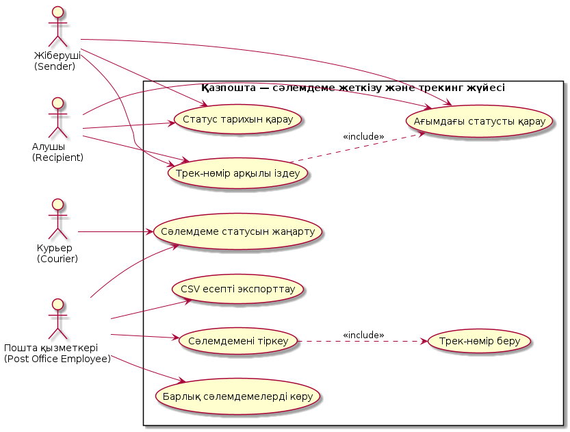
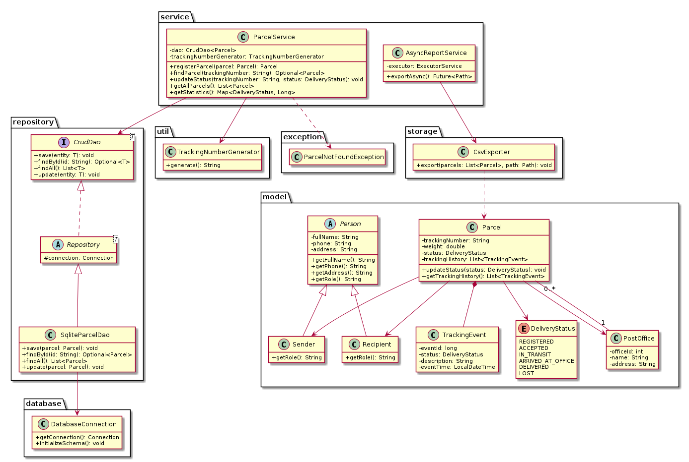
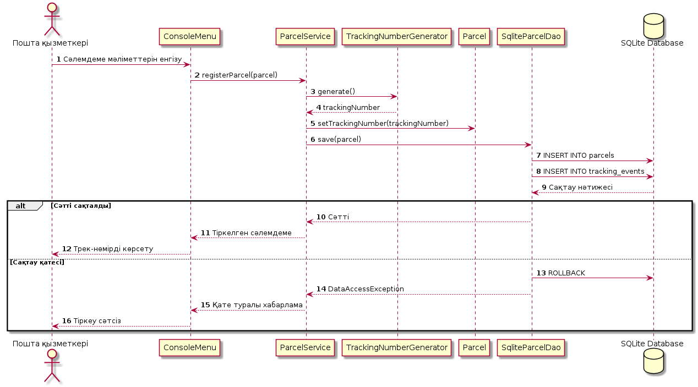
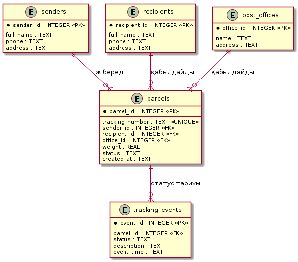

# Қазпошта сәлемдемелерін жеткізу және трекинг жүйесі

**Жоба нұсқасы:** 16  
**Бағдарламалау тілі:** Java 17  
**Ұйым:** «Қазпошта» АҚ

## 1. Жобаның мақсаты

Қазпошта сәлемдемелерін тіркеу, трек-нөмір арқылы іздеу,
жеткізу статусын жаңарту және статус тарихын сақтау жүйесін әзірлеу.

## 2. Мәселе және шешім

Мәселе: сәлемдемелердің статустарын бақылау және жеткізу
кезеңдері туралы ақпаратты жүйелі сақтау қажеттілігі.

Шешім: сәлемдемелерді тіркейтін, бірегей трек-нөмір беретін,
статустарын жаңартып, олардың тарихын SQLite деректер
қорында сақтайтын консольдік жүйе.

## 3. Жүйенің функциялары

1. Сәлемдемені тіркеу.
2. Трек-нөмір арқылы іздеу.
3. Барлық сәлемдемелерді көру.
4. Сәлемдеме статусын жаңарту.
5. Статус тарихын қарау.
6. Статистика шығару.
7. CSV есебін фондық ағынмен экспорттау.
8. OOP қағидаларын демонстрациялау.

## 4. Қолданылған технологиялар

- Java 17
- Apache Maven
- SQLite
- JDBC
- JUnit 5
- Git және GitHub
- PlantUML

## 5. OOP қағидалары

- Инкапсуляция: Person және Parcel кластарындағы private өрістер.
- Мұрагерлік: Sender және Recipient → Person.
- Абстракция: abstract Person және Repository<T>.
- Полиморфизм: Person типі арқылы Sender және Recipient әдістерін шақыру.
- Интерфейс: CrudDao<T>.
- Enum: DeliveryStatus.

## 6. Коллекциялар және Stream API

- List — сәлемдемелер тізімі.
- Set — бірегей трек-нөмірлер.
- Map — статус бойынша статистика.
- filter — салмағы бойынша сүзу.
- map — трек-нөмірлерді алу.
- groupingBy — статус бойынша топтау.

## 7. Деректер қорымен жұмыс

SQLite және JDBC қолданылады.
DAO үлгісі арқылы деректерді сақтау, іздеу және жаңарту орындалады.
Тіркеу және статус жаңарту операцияларында транзакция,
commit және rollback қолданылады.

## 8. Файлдар және көпағындылық

CSV есебі reports/parcels.csv файлына экспортталады.
Экспорт CompletableFuture және ExecutorService арқылы
фондық ағынмен орындалады.

## 9. Жобаны іске қосу

Қажетті құралдар: JDK 17 және Maven.

Тесттерді орындау:

    mvn clean verify

Бағдарламаны іске қосу:

    mvn exec:java

## 10. Тестілеу

JUnit 5 арқылы 19 тест орындалды.
Соңғы тексеру нәтижесі: 19 тест, 0 қате, BUILD SUCCESS.

## 11. UML диаграммалары

### Use Case

### Class

### Sequence

### Database Schema

## 12. Репозиторий құрылымы

    java-project-aiym-16/
    ├── README.md
    ├── docs/
    │   ├── research.md
    │   └── uml/
    │       ├── use-case.puml
    │       ├── use-case.png
    │       ├── class.puml
    │       ├── class.png
    │       ├── sequence.puml
    │       ├── sequence.png
    │       ├── database-schema.puml
    │       └── database-schema.png
    ├── src/
    │   ├── main/java/
    │   └── test/java/
    ├── data/
    ├── pom.xml
    └── .gitignore